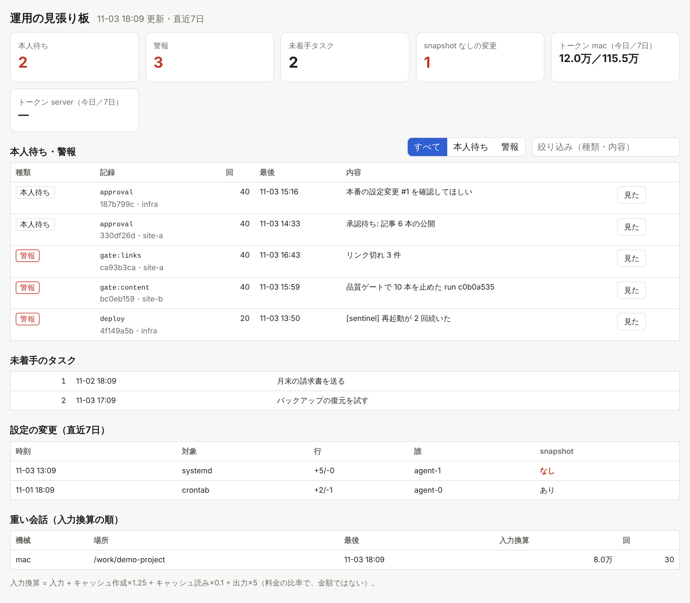

# ops-dashboard-ts

一人で回している AI 自動化の運用状況を 1 枚で見る「見張り板」です。
エージェントが止まった件（人の判断待ち・警報）、未着手のタスク、本番設定の変更、Claude Code のトークン使用量をまとめて表示し、
確認した件は画面の「見た」ボタンで消せます。



<sub>画面はリポジトリ同梱の `scripts/seed-demo.ts` で作った架空のデータです。</sub>

## 目的

もともとは Python スクリプト（`ops_dash.py`）が 10 分おきに静的 HTML を書き出していました。これを TypeScript に書き直し、

- 生きた API と、絞り込み・検索のできる画面にする
- 確認済みにする操作を CLI コマンドから画面のボタンに移す
- **同じデータファイルを読み書きし、Python 版と並べて動かせる**（移行中も両方が同じ判定をする）

ことを目的にしています。

## 構成

| | |
|---|---|
| API | [Hono](https://hono.dev) + Node 22。SQLite は組み込みの `node:sqlite` で読む（ネイティブモジュールなし） |
| 画面 | React 19 + Vite。TypeScript `strict`（`noUncheckedIndexedAccess`、`exactOptionalPropertyTypes` も有効） |
| テスト | Vitest。Python の元ロジックに同じ入力を流して結果の完全一致を確かめる一致テストを含む |
| CI | GitHub Actions（依存の脆弱性検査・型検査・テストとカバレッジ・ビルド・起動確認）。一致テストは Python 3.10 と 3.12 の両方で実行 |

## 使い方

Node 22.13 以上（`node:sqlite` のため）と、一致テスト用に Python 3.10 以上が必要です。

### デモデータで試す

```bash
npm ci
```

```bash
npm run build
```

```bash
npm run demo:seed -- ./demo 200
```

```bash
OPS_LEDGER_DB=./demo/agent_ledger.db OPS_CHANGES_DB=./demo/changes.db OPS_STATE=./demo/state.json OPS_USAGE_MAC=./demo/usage_mac.json OPS_USAGE_CMD= npm start
```

ブラウザで http://localhost:8787 を開きます。

### 本番

サーバは `127.0.0.1` にだけ待ち受けるので、手元からは SSH トンネルで見ます。

```bash
ssh -L 8787:127.0.0.1:8787 server
```

### 環境変数

| 変数 | 既定値 | |
|---|---|---|
| `OPS_LEDGER_DB` | `~/agent_ledger.db` | エージェントのイベントとタスクの SQLite |
| `OPS_CHANGES_DB` | `~/ops/changes.db` | 設定変更の記録（無ければ空として扱う） |
| `OPS_STATE` | `~/ops/ops_dash_state.json` | 確認済み（ack）の記録。Python 版と共有 |
| `OPS_USAGE_MAC` | `~/ops/usage_mac.json` | 手元の機械のトークン使用量 |
| `OPS_USAGE_CMD` | `python3 ~/cc_usage.py ...` | サーバ側の使用量を出すコマンド。空で無効。空白を含むパスは JSON 配列で書く（`["python3","/a b/cc_usage.py"]`） |
| `OPS_DAYS` | `7` | 表示する日数（1〜90） |
| `PORT` / `HOST` | `8787` / `127.0.0.1` | 待ち受け先 |
| `OPS_ALLOWED_HOSTS` | なし | `localhost` 以外の名前で開く場合に、許す Host 名をカンマ区切りで追加 |

`PORT` や `OPS_DAYS` に範囲外や数字でない値が入っていると、起動時に理由を表示して終了します（終了コード 2）。以前は、たとえば `OPS_DAYS=abc` のまま起動し、エラーも出さずに件数 0 と表示していました。

### 開発用コマンド

| コマンド | |
|---|---|
| `npm run dev:api` / `npm run dev:web` | API と画面の開発サーバ（Vite が `/api` を API に中継） |
| `npm run typecheck` | 型検査（画面とサーバの両方） |
| `npm test` / `npm run test:coverage` | テスト / カバレッジつきテスト |
| `npm run smoke` | ビルド済みサーバをデモデータで起動し、画面・資産・API・ack・Host 検査・404 を確かめる |
| `npm run bench` | 合成データで `GET /api/items` の応答時間を測る |

## API

| メソッド | パス | |
|---|---|---|
| GET | `/api/health` | 死活確認 |
| GET | `/api/items` | 直近 N 日の未確認の件（本人待ちが先、新しい順） |
| GET | `/api/tasks` | 未着手のタスク |
| GET | `/api/changes?days=7` | 検出した設定変更と、snapshot を取ってからの変更か |
| GET | `/api/usage` | 機械ごとのトークン使用量（今日・7日、重い会話） |
| POST | `/api/ack` | `{ "key": "<4〜8桁の16進>" }` に前方一致する件を確認済みにする |

エラーはすべて JSON（`{ "error": "..." }`）で返します。台帳の DB が見つからないときは 503（ファイル名だけを返し、ホームディレクトリのパスは出さない）、
未定義の `/api/*` は 404 です。

## Python 版との一致テスト

件は `sha1(event_type + "|" + norm(summary))[:8]` でまとめ、ack は ISO 文字列として保存し**文字列のまま比較**しています。
Python と JavaScript の細かな違いがあると、同じ件が別々に分かれたり、確認済みの件がまた出てきたりします。
そこで `test/reference.py`（`ops_dash.py` から写した元ロジック）に同じ入力を流し、まとめ方・キー・回数・時刻・並び順・ack による非表示が完全に一致することを確かめています。

| Python の挙動 | TS 側の対応 |
|---|---|
| `\d` は全角数字（`０１２`）などにも一致する | `u` フラグつきの `\p{Nd}` |
| `s[:48]` はコードポイント単位で切る | `Array.from(s).slice(0, 48)` |
| `isoformat()` はマイクロ秒を 6 桁で出し、0 なら省く | 同じ形で整形 |
| 時刻の無い台帳の値は UTC | 同じく UTC とみなし、JST（+09:00）で表示 |
| 2月30日・13月・24時・60分・0年・24時間以上の時差は `ValueError` | 範囲外は `null`（以前は繰り上げて別の日時にしていた） |
| 1〜9999 年を正確に扱う | 秒とマイクロ秒を分けて持つ（1 つの数にすると 1970 年から約 285 年より遠い日付で精度が落ちる） |
| 本番の 3.10 は `20260930`・`T01`・`.1` などを受け付けない（3.11 以降は受け付ける） | 3.10 に合わせて `null` |

決まった例のほか、シード固定の乱数で作った 3,000 個の日時文字列と 2,000 行のイベントでも一致を確かめています。

## 安全のための対策

- **ack の CSRF**：`POST /api/ack` には `x-ops-ack: 1` ヘッダが必須。別のオリジンのページは CORS の事前確認なしにこのヘッダを付けられず、このサーバは事前確認に応じない。
- **DNS rebinding**：悪意のあるサイトが自分のドメイン名を 127.0.0.1 に向け直すと、ブラウザからは同じオリジンに見え、上のヘッダも付けられてしまう。
  そこで `Host` ヘッダの名前が許可した名前（`localhost`・`127.0.0.1`・`[::1]` と `OPS_ALLOWED_HOSTS`）でなければ 421 で断る。
  ポートは見ないので、SSH トンネルで別のローカルポートを使っても開ける。
- **クリックジャッキング・その他**：全応答に `X-Frame-Options: DENY`、`Content-Security-Policy`（`frame-ancestors 'none'` など）、`X-Content-Type-Options: nosniff`、`Referrer-Policy: no-referrer` を付け、API は `Cache-Control: no-store`。
- **状態ファイルを壊さない**：状態ファイルが壊れていて読めないとき、ack はそれを空の状態で上書きせず 409 を返す（以前は上書きし、Python 版が書いた `seen` などを消していた）。書き込みは一時ファイルに書いてから rename する。

## 実測結果

以下はこのリポジトリで実際にコマンドを実行して得た数字です（2026-11-03、Linux コンテナ、Node v22.23.4、Intel Xeon 2.10GHz × 4）。

### テスト・カバレッジ（`npm run test:coverage`）

- テストファイル 6 件、テスト 59 件、すべて成功
- 一致テストは Python 3.10.20 / 3.11.18 / 3.12.3 / 3.13.18 のそれぞれで 7 件すべて成功
- カバレッジ（`src/server/*.ts` と `src/web/api.ts`。起動処理の `main.ts` は除き、`npm run smoke` で確認）

| | 文 | 分岐 | 関数 | 行 |
|---|---:|---:|---:|---:|
| 全体 | 97.23% | 89.49% | 97.05% | 97.58% |

追加したテストのうち 11 件は、修正前のコードでは失敗することを確かめています（範囲外の日時、Host 検査、セキュリティヘッダ、DB が無いときの 503、未定義 API の 404、壊れた状態ファイルの保護）。

### ビルド（`npm run build`）

| ファイル | サイズ | gzip |
|---|---:|---:|
| `index.html` | 0.40 kB | 0.29 kB |
| CSS | 2.35 kB | 0.93 kB |
| JS | 226.28 kB | 70.93 kB |

### 応答時間（`npm run bench`）

デモデータ（グループ数 5）で `GET /api/items` をプロセス内で 30 回呼んだ値（最初の 3 回は除外）です。
修正前（`b6f99eb`）と修正後を、同じマシン・同じスクリプトで続けて測りました。

| blocked 行数 | 修正前 中央値 | 修正後 中央値 | 修正前 p95 | 修正後 p95 |
|---:|---:|---:|---:|---:|
| 900 | 6.1 ms | 5.1 ms | 7.6 ms | 8.6 ms |
| 9,000 | 46.9 ms | 33.9 ms | 66.8 ms | 55.1 ms |
| 90,000 | 536.1 ms | 388.7 ms | 905.9 ms | 671.6 ms |

行ごとに行っていた sha1 の計算を正規化後の文字列ごとに 1 回にし、日時の文字列化をグループの first/last だけにしました。
1 回ごとのばらつきはあり、81,000 行で測り直したときは 修正前 480.5 ms → 修正後 347.7 ms（中央値）でした。
残りの時間の多くは SQLite からの読み出しです。

## ライセンス

MIT
